# Dolores Hoy

Tablero en Flutter que consume **5 APIs gratuitas** aplicando buenas prácticas de seguridad.
Desarrollo Móvil Integral · UTNG
## APIs utilizadas

| # | API | Dato | Clave |
|---|-----|------|-------|
| 1 | Open-Meteo | Clima actual de Dolores Hidalgo | No |
| 2 | Frankfurter | Tipo de cambio peso-dólar-euro | No |
| 3 | Nager.Date | Próximos días festivos de México | No |
| 4 | Wikipedia (es) | Resumen de Dolores Hidalgo | No |
| 5 | NASA APOD | Foto astronómica del día | Sí |

## Medidas de seguridad aplicadas

- **HTTPS obligatorio:** `ClienteSeguro` rechaza cualquier dirección `http://` antes de enviar datos.
- **Claves fuera del código:** la clave de la NASA entra al compilar con `--dart-define-from-file=secrets.json`; el archivo está en `.gitignore`.
- **Plantilla sin secretos:** se sube `secrets.json.example` con `DEMO_KEY`.
- **Timeout de 8 segundos y límite de 1 MB** por respuesta.
- **Validación de entradas:** coordenadas, años y texto de Wikipedia (vacío, longitud, caracteres de control).
- **Protección contra path injection:** las rutas se arman con `pathSegments`.
- **Validación de salidas:** tipos de datos, `media_type` y URLs de imagen solo `https`.
- **Logs sin secretos:** `ClienteSeguro.redactar()` oculta la clave y `ConfigClaves.toString()` no la imprime completa.
- **Errores seguros:** los errores inesperados muestran un mensaje genérico al usuario.
- **Resiliencia:** si una API falla, las otras cuatro siguen funcionando.

## Cómo ejecutarlo

    copy secrets.json.example secrets.json
    flutter pub get
    flutter run --dart-define-from-file=secrets.json

Para usar tu propia clave, regístrala gratis en https://api.nasa.gov y ponla en `secrets.json`.

## Pruebas

    flutter test

## Evidencias

### Pruebas
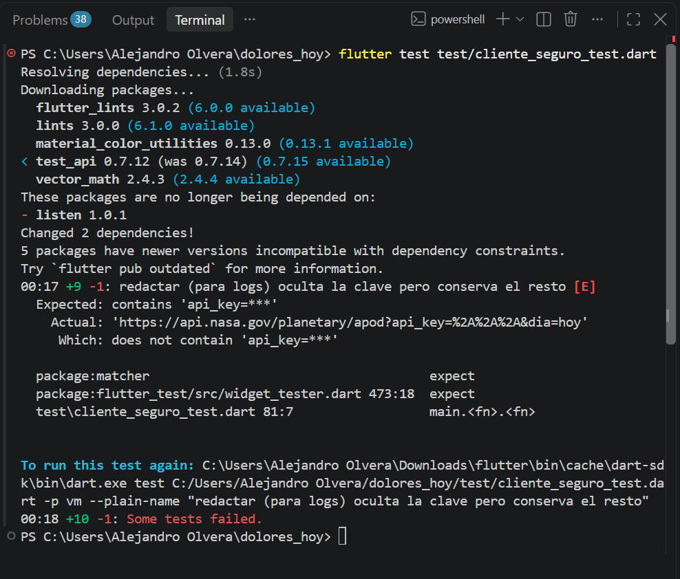
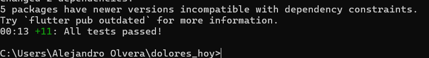
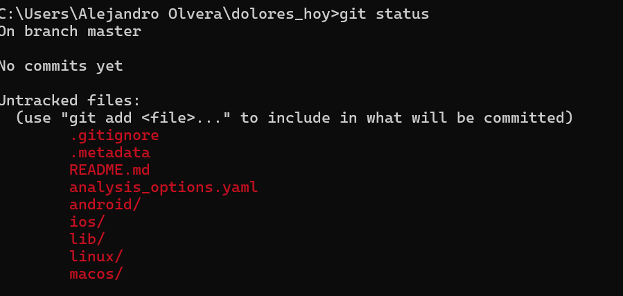
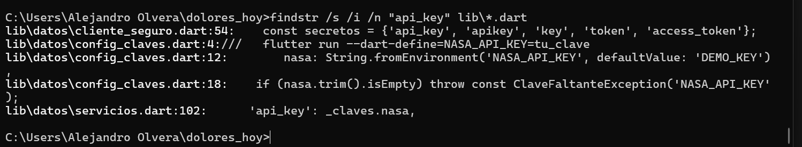
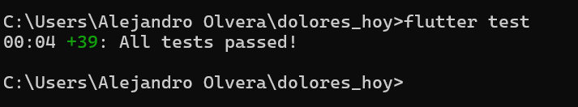

### App
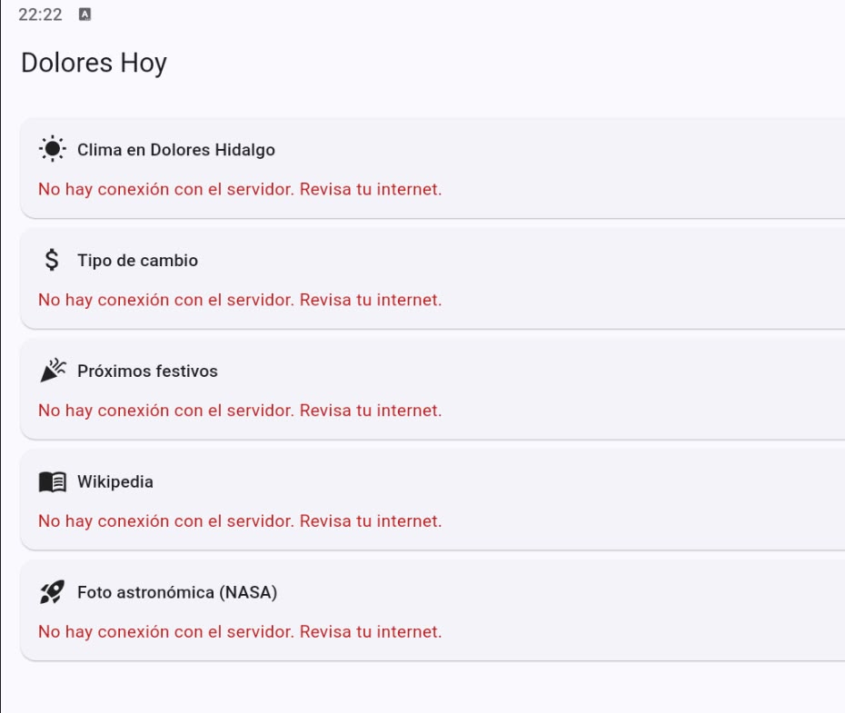
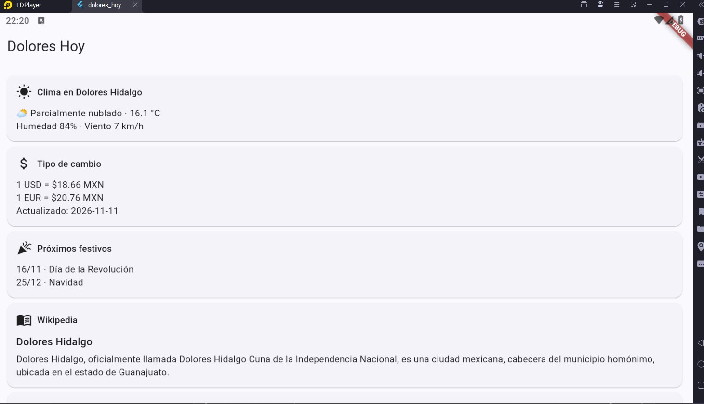
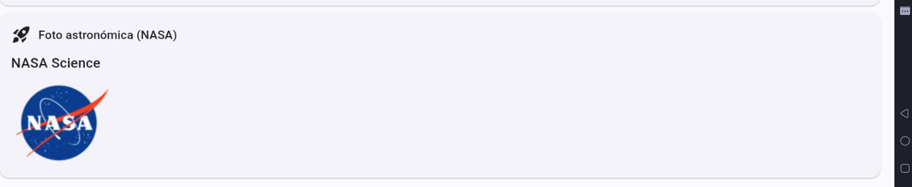

## Evidencia de TDD (ciclo Rojo → Verde por ronda)

En cada ronda se escribe primero la prueba, se ve fallar (rojo), se implementa lo mínimo para que pase (verde) y después se mejora el código.

### Ronda 1: Cliente seguro
**Rojo:** la prueba falla porque aún no existe `cliente_seguro.dart`.

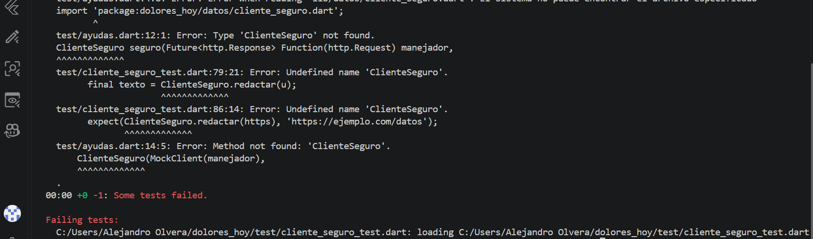

**Verde:** con `cliente_seguro.dart` implementado, la prueba pasa.

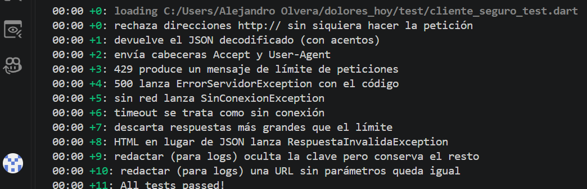

### Ronda 2: Seguridad (claves y configuración)
**Rojo:**

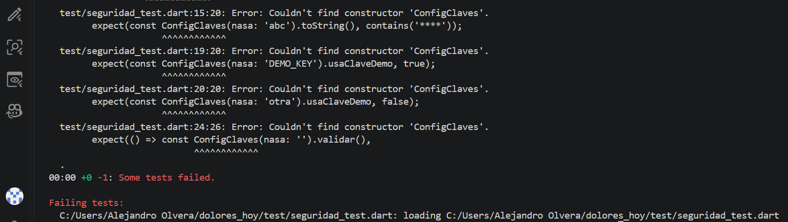

**Verde:**

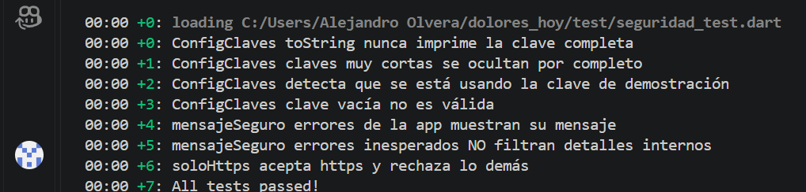

### Ronda 3: Servicios (las 5 APIs)
**Rojo:**

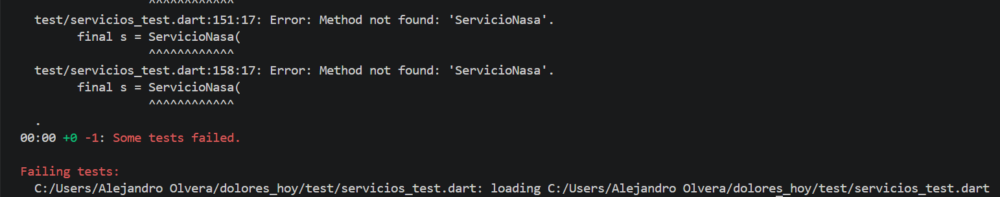

**Verde:**

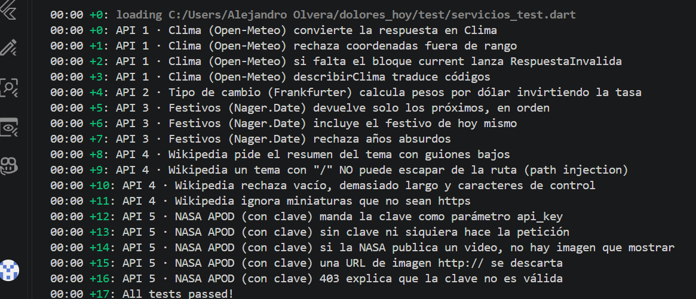

### Ronda 4: TableroViewModel
**Rojo:**

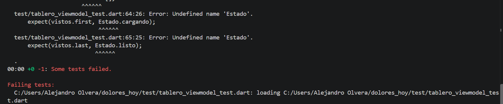

**Verde:**

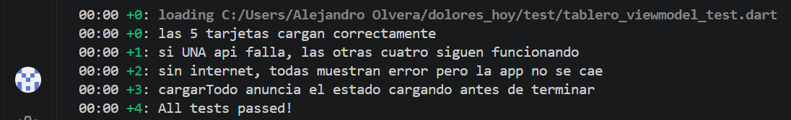

### Resultado final: todas las pruebas pasando
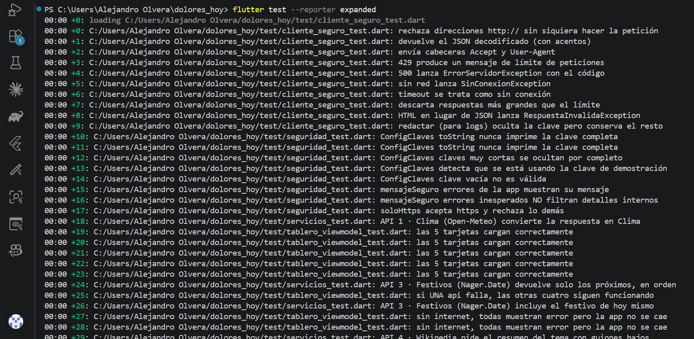
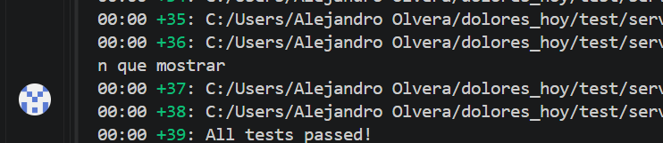